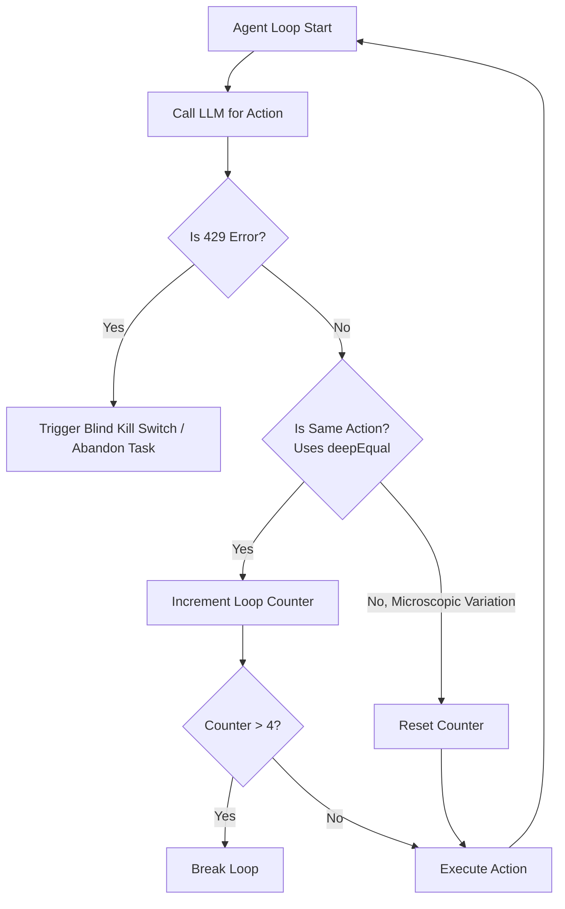
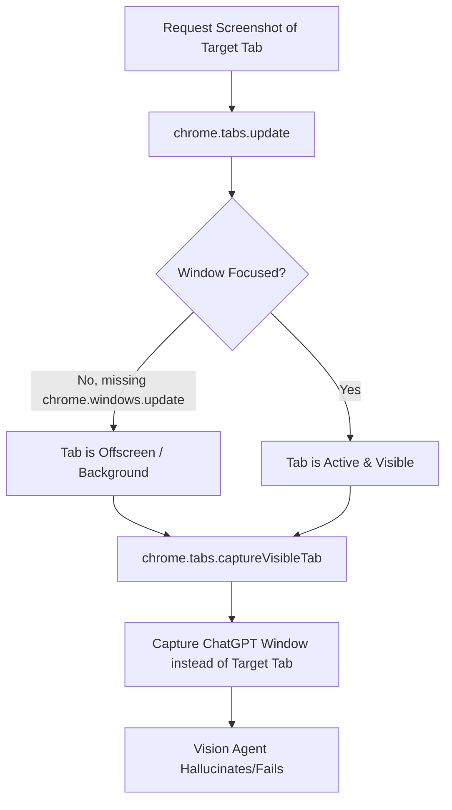
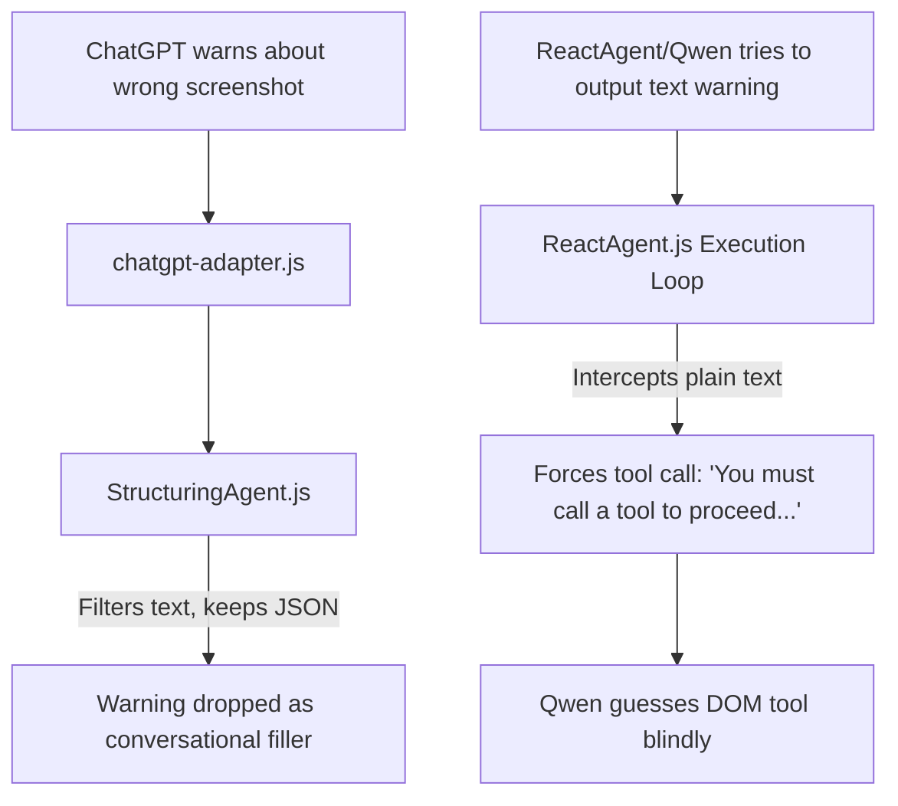

# Architecture Hypothesis & Findings

This document outlines critical architectural bugs and hypotheses identified across multiple agent modules in the FollowMe Extension system, merging the original Scavenger findings with the Validator's corrections.

## 1. ReactAgent Loophole & Rate Limiting

The `ReactAgent` suffers from a significant flaw in its loop detection mechanism. The detector relies on `deepEqual` for arguments to identify if an action is repeating. However, LLMs frequently introduce microscopic variations in arguments (e.g., `target: "login"` vs `"Login"`). This bypasses the loop detector, preventing the 4-match limit from firing and resulting in a runaway state machine loop. A hard static limit on loop iterations is required.

Furthermore, OpenRouter 429 rate limit errors currently trigger a blind kill switch, abandoning tasks entirely instead of implementing a robust exponential backoff strategy.

## 2. Subphase3Orchestrator Screenshot Bug

A critical race condition exists where the ChatGPT tab is captured instead of the target tab. This is exacerbated because the current implementation uses `chrome.tabs.update(tabId, { active: true })`, which activates the tab but does not guarantee the window containing the tab is focused (missing `chrome.windows.update`). Consequently, the tab might remain offscreen, leading to the vision module capturing the incorrect context.

## 3. GhostScout / NavigationAgent Bug

The `NavigationAgent` fails gracefully on hallucinated URLs without dots (e.g., `saratha_v2`) by falling back to Google Search. However, a severe bug occurs when the LLM hallucinates a domain *with* a dot (e.g., `saratha.v2` or `fake.com`). This bypasses the search check and the agent attempts to execute navigation directly, leading to failure.

Additionally, `GhostScout` incorrectly resets `triageAttempts` to 0 after 3 failed popup closes. This creates an infinite triage loop where popups are never successfully dismissed, causing the agent to remain stuck.

## 4. Memory Manager & Fallback UI

The fallback UI implementation in `askForHelp` hardcodes the tooltip string instead of dynamically utilizing the provided `instruction`.

In the `MemoryManager`, the context pruning mechanism has been commented out. This leads directly to context bloat over long sessions, inevitably culminating in 400 Context Length Exceeded errors from the LLM API provider.

## 5. The Muzzle Effect (ReactAgent Ignoring Textual Warnings)

**Why ReactAgent Ignores Textual Warnings from ChatGPT:**
1. **StructuringAgent Filters Text:** When ChatGPT's response is scraped by `chatgpt-adapter.js` (which works properly but has a slight race-condition risk with `isGenerating`), it is sent to `StructuringAgent.js`. However, `StructuringAgent.js` explicitly instructs the LLM to output ONLY strict JSON for digital actions and explicitly ignore "conversational filler." Thus, ChatGPT's plain-text warning is treated as filler and silently dropped.
2. **ReactAgent Muzzles the AI:** If Qwen (`ReactAgent`) receives the raw text context and attempts to output a plain-text response (e.g. "I cannot proceed, the screenshot is broken"), the `ReactAgent.js` execution loop actively intercepts it. It automatically replies to Qwen: `"You must call a tool to proceed. Use 'task_complete' if you are done."` This fallback mechanism acts as a muzzle, forcing Qwen to blindly guess a DOM tool rather than correctly pausing or relaying the warning.

