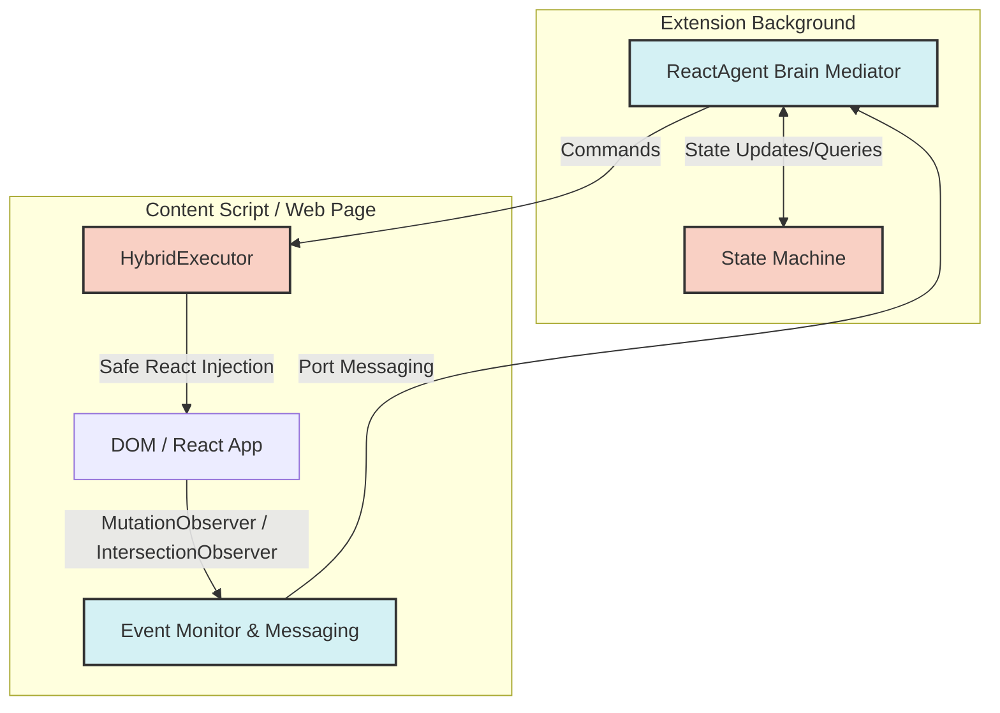
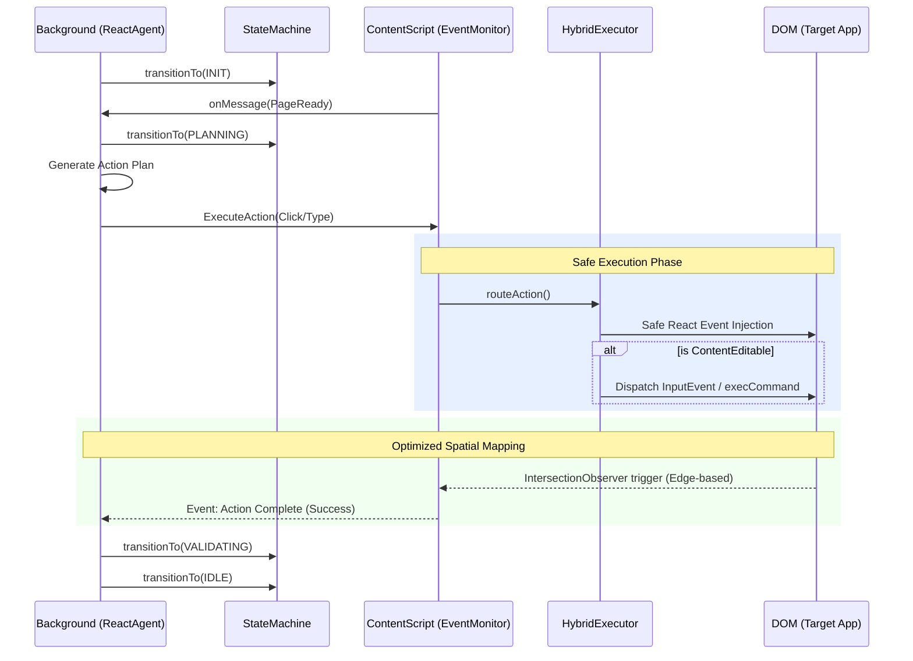

# Architecture Hypothesis: Integrated Pipeline (Previous Version + ReactAgent)

## Executive Summary
The previous iteration of the extension's automation pipeline relied heavily on a State Machine and a `HybridExecutor` pattern. While conceptually sound for state tracking, recent validator findings exposed severe architectural flaws in its execution mechanics. 

This document outlines the resolved, integrated architecture which combines the robust `State Machine` and `HybridExecutor` from the legacy system with the `ReactAgent` acting as the central "Brain" mediator. Crucially, it replaces the flawed legacy mechanisms with robust, modern browser automation patterns.

## Addressed Validator Findings & Resolutions

1. **Flawed 500ms Polling Loop**
   - *Issue*: Background tabs heavily throttle JavaScript timers, leading to missed responses and broken state transitions.
   - *Resolution*: Replaced polling with a **Message-Driven Event Architecture** using `chrome.runtime.sendMessage` and long-lived ports. The `ReactAgent` now mediates these events asynchronously without relying on `setInterval`.

2. **Destructive Native Property Setters**
   - *Issue*: Directly setting native properties bypassed React's synthetic event system but caused destructive failures on complex `contenteditable` elements (e.g., Claude, Notion).
   - *Resolution*: Implemented **Safe React Event Injection**. The `HybridExecutor` now carefully dispatches synthetic React events (e.g., `onChange`, `onInput`) and utilizes `document.execCommand` or `InputEvent` APIs where appropriate for `contenteditable` elements to maintain application state integrity.

3. **VERIFY_AND_SNAP Layout Thrashing**
   - *Issue*: The spatial verification used a hardcoded 120px radius measured from the center of elements. This failed on large structural elements and caused severe layout thrashing due to forced synchronous layouts during measurement.
   - *Resolution*: Replaced with an **Optimized Spatial Mapping Algorithm**. Uses `IntersectionObserver` and edge-based bounding box intersection checks (using `getBoundingClientRect()` cached via `requestAnimationFrame`) to determine spatial proximity without layout thrashing.

## Integrated Architecture 

The new architecture operates in three layers:
1. **Brain Mediator**: `ReactAgent` orchestrates the plan and handles complex logic.
2. **State Management**: The Legacy `StateMachine` tracks the current phase of execution.
3. **Execution**: The `HybridExecutor` performs the actual DOM manipulation using the new safe methods.

### System Flowchart

### Execution Pipeline Visualization

## Conclusion
By preserving the architectural skeleton of the `previous_version` (State Machine + HybridExecutor) but replacing the brittle execution and monitoring implementations with `ReactAgent` mediation, event-driven messaging, and safe DOM interactions, the extension achieves both high reliability and deep integration with complex web applications.
