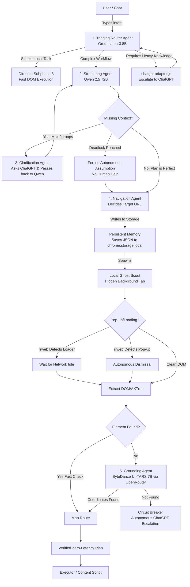

# Phase 3: The Agentic Autonomy Layer (Subphase Breakdown)

This implementation plan details **Phase 3** of the FolloMe Architecture. To ensure proper execution and pairing, Phase 3 is divided into distinct, manageable **Subphases**. 

Based on our discussion, we have upgraded **Subphase 1** to utilize a **Micro-Agent Choreography** architecture. It operates on a Shared Blackboard for context sharing, strictly removes human-in-the-loop for planning, and enforces FolloMe's core identity constraints.

---

## Architectural Flowchart (Phase 3 Pipeline)

---

## Subphase 1: Micro-Agent Choreography (The Planning Pipeline)

To make Subphase 1 extremely efficient, low latency, and modular, we are employing a **Micro-Agent Choreography** pattern. 

### The Shared Context Layer (The Agentic Blackboard)
To ensure the 4 agents don't operate in isolated silos, they utilize a **Shared Blackboard Pattern**. 
A single `ContextObject` (containing the user's intent, the active DOM URL, and the structured plan thus far) is passed sequentially from Agent 1 to Agent 4. 
- Agent 1 appends the `triaged_intent`.
- Agent 2 appends the `structured_json`.
- Agent 3 appends `clarification_answers`. 
Every agent reads from and writes to the exact same JSON context state in memory, ensuring perfect harmony before it is finally saved to `chrome.storage.local`.

### The FolloMe Identity & Constraints
To ensure the agents act autonomously but safely, Subphase 1 is strictly bound by the **FolloMe Identity System Prompt**:
* **Identity:** "You are FolloMe, a web browser agent designed to guide users via UI tooltips or execute autonomous web tasks."
* **Capabilities:** You CAN click, scroll, navigate, and read public DOM state.
* **Hard Boundaries:** You CANNOT and WILL NOT attempt to type passwords, perform user logins, solve CAPTCHAs, or input personal information. 
* **The Exception:** The only time personal information can be filled is if the data was *explicitly* provided in the ChatGPT intent (e.g., "Enter 'John Doe' in the name field").
* **Behavior:** If a user demands an out-of-bounds action (e.g., "Log me into my bank"), the Triaging Agent immediately rejects the request with a polite explanation of its boundaries, bypassing any heavy LLM processing.

### The Agent Roster
#### Agent 1: The Triaging Router Agent (Groq Llama-3 8B)
* **Responsibility:** The ultimate gatekeeper. It intercepts every request and determines the execution path while strictly enforcing the FolloMe Identity Constraints.

#### Agent 2: The Structuring Agent (Qwen 2.5 72B Instruct)
* **Responsibility:** Takes the raw intent from the Blackboard and organizes the steps into a strict, stateful JSON execution plan grouped by domain.

#### Agent 3: The Clarification Agent (The Autonomous Resolver)
* **Responsibility:** Handles communication with ChatGPT if Agent 2 raises a `clarification_needed` flag.
* **Deadlock Resolution:** The system will loop a max of 2 times. The human user is **never** asked for planning help. If a deadlock occurs, Qwen autonomously makes the most logical assumption based on the Shared Blackboard context.

#### Agent 4: The Navigation Agent (Lyto-Style Routing)
* **Responsibility:** Reads the completed JSON from the Blackboard, determines the exact secure URL for the first block of steps, and hands off the finalized payload to `chrome.storage.local`.

### Subphase 1: Technical Execution Plan

To build this Multi-Agent Pipeline, we will implement the following file structure, borrowing algorithms and patterns from our reference extensions:

#### 1. File Structure & Component Creation
All agentic routing will live in the background worker to ensure it survives tab closures.
* **`background/agents/AgenticBlackboard.js`**: A JavaScript Class that holds the state `ContextObject`. It provides strict `get()` and `set()` methods for the agents to update the intent, JSON plan, and URL safely. (Inspired by MultiOn's internal background state-trackers).
* **`background/agents/TriagingAgent.js`**: Uses `api/groq-client.js`. Contains the strict "FolloMe Identity" system prompt and outputs an enum: `[LOCAL, PLAN, ESCALATE]`.
* **`background/agents/StructuringAgent.js`**: Uses `api/open-router-client.js`. We will enforce **JSON Schema Mode** natively in the API call so Qwen 2.5 72B is physically unable to return malformed text, eliminating retry loops.
* **`background/agents/ClarificationAgent.js`**: A wrapper around our existing `chatgpt-adapter.js`. It tracks a `loop_count` variable and forcefully breaks the loop if `loop_count >= 2`.
* **`background/agents/NavigationAgent.js`**: Adapts routing heuristics from **Lyto's Architecture**, maintaining a URL resolution map to decide which domain to navigate to based on Qwen's JSON domain tags.
* **`background/MultiStagePlanner.js`**: The Orchestrator. It instantiates the `AgenticBlackboard` and sequences the agents using **pure native JS `async`/`await`** (the JavaScript equivalent of Python's `asyncio`). We deliberately avoid bloated frameworks (like LangChain.js) to ensure zero abstraction overhead and maximum real-time performance.

#### 2. API Integrations
* **Groq API:** We need to ensure the Groq API key is stored securely in `.env` and accessed via the background script.
* **OpenRouter API:** Used to hit Qwen 2.5 72B. We will utilize the `response_format: { type: "json_object" }` parameter.

#### 3. Execution Flow
1. User hits `Cmd+Shift+K` or background watcher triggers.
2. `MultiStagePlanner.js` creates a new `AgenticBlackboard(raw_input)`.
3. Passes to `TriagingAgent`.
4. If `PLAN`, passes to `StructuringAgent`.
5. If missing context, passes to `ClarificationAgent` (max 2 loops).
6. Passes to `NavigationAgent`.
7. `MultiStagePlanner.js` extracts the final JSON from the Blackboard and writes it to `chrome.storage.local`.

---

## The Persistent Memory System (Where the Plan Lives)

1. **Storage Mechanism (`chrome.storage.local`):** The finalized context payload from Subphase 1 is written to `chrome.storage.local` under `folloMeActivePlan`. 
2. **State Tracking (The Offscreen Brain):** The `offscreen.html` document monitors this storage, marking steps as `"status": "completed"` as they execute.
3. **Cross-Tab Continuity:** Because new tabs immediately read `folloMeActivePlan` from storage, memory never vanishes when switching domains.

### User Modification (Intent Classification)
If the user asks a question via the **Cursor UI** (`Cmd+Shift+K`) mid-execution:
* **Classification A (Small Doubt):** Agent 1 pauses the plan, answers the question via a tooltip, and resumes the exact next step. The stored plan is untouched.
* **Classification B (Plan Divergence):** Agent 1 recognizes a major intent shift. Execution pauses, the new intent flows through the Blackboard (Agents 2 & 3), and Qwen determines whether to append or replace steps in `chrome.storage.local`.

**Crucially: Subphases 2 and 3 operate *strictly* on whatever is currently at the top of the queue in `chrome.storage.local`. They are pure execution engines.**

---

## Subphase 2: The Ghost Scout & Incremental State Streaming

### Step 2.1: The Local Ghost Scout
* Opens `chrome.tabs.create({ active: false })` to navigate to the URL decided by the Navigation Agent.

### Step 2.2: `rrweb` State Tracking (No-Screenshot Optimization)
* **Loading Detection:** `rrweb` streams DOM mutations. If the page is buffering, the Scout waits for a 500ms "Mutation Idle" state before doing anything. 
* **Pop-up Prediction:** If `rrweb` streams a sudden block of new DOM nodes with a high `z-index`, the Scout extracts *only* that new DOM chunk, passes it to the Fast LLM (Groq) to find the "Close" button, and dismisses it.

---

## Subphase 3: Grounding Orchestration & Vision Execution

**It only executes the active step found in `chrome.storage.local`.**

### Step 3.1: Fast Path (DOM Grounding)
* Extracts the Pseudo-Accessibility Tree and uses Groq Llama-3 8B to quickly find the button in the text if it's explicitly labeled.

### Step 3.2: Vision Path (ByteDance UI-TARS 7B)
* If the element is hidden, the Scout takes a compressed screenshot and queries **ByteDance UI-TARS 7B via OpenRouter** for exact coordinates.

### Step 3.3: The Escalation Matrix & Circuit Breaker
* If the agent scrolls twice and UI-TARS still can't find the element, the Circuit Breaker trips.
* The agent halts, switches to the background ChatGPT tab, and autonomously types a clarification request.

### Step 3.4: Visual Annotations
* Passes a verified DSL array to the visible tab's Executor to draw the dashed boxes and pointers for the user.

---

## Appendix: Subphase 2 & 3 Backend Execution Pipelines

This section details the robust backend algorithms and orchestration pipelines that run behind the scenes to link and execute Subphase 2 and Subphase 3, moving away from simple API calls to concrete controllers.

### 1. The Local Ghost Scout (Backend Pipeline)
Instead of a simple tab creation script, we use a robust background controller to track state.
* **Algorithm:**
  1. **Instantiation:** The `service-worker.js` instantiates a new `GhostScoutOrchestrator` when a plan is finalized in Subphase 1.
  2. **Tab Creation:** It spawns the background tab via `chrome.tabs.create({ url: targetUrl, active: false })` and maps the `tabId` to its internal state tracker (`scoutMap.set(tabId, state)`).
  3. **Injection Assurance:** Uses `chrome.scripting.executeScript` to forcefully inject `rrweb-tracker.js` and `context-extractor.js` immediately when the `onUpdated` status is "loading".
  4. **Timeout Watchdog:** Initiates a 15,000ms timeout watchdog. If the page completely hangs and no idle event fires, it forces a `PAGE_SETTLED` state to prevent deadlocks.

### 2. State Tracking & Popup Handling (Backend Pipeline)
* **Algorithm:**
  1. **Mutation Debouncing:** `rrweb-tracker.js` attaches a `MutationObserver` to `document.body`. Every DOM mutation resets a 500ms debounce timer.
  2. **Popup Detection Heuristic:** Inside the observer, it checks new elements for `getComputedStyle(node).zIndex > 100` AND bounding boxes covering >20% of the viewport.
  3. **Triage Loop:** If a popup is found, it sends `POPUP_DETECTED` with the raw HTML to the background. The orchestrator queries the Fast LLM (Groq Llama-3 8B) for the `css_selector` of the close button. A synthetic click is dispatched to that selector, and the debounce timer resets.
  4. **Idle State:** When 500ms passes silently, `NETWORK_IDLE` is fired, triggering Sub-phase 3.

### 3. Fast Path (DOM Grounding) Pipeline
Triggered sequentially over the active steps found in `chrome.storage.local`.
* **Algorithm:**
  1. **Pseudo-AXTree Extraction:** `context-extractor.js` traverses the DOM, filtering out invisible nodes. Interactive elements get a unique `folloMeId` mapped to their `BoundingClientRect`.
  2. **Minification:** A stripped-down, indented text tree (Roles, Text, IDs) is generated.
  3. **LLM Resolution:** The orchestrator sends this text + the intended action (e.g., "Click Create") to Groq Llama-3 8B. 
  4. **Validation:** The LLM returns the `folloMeId`. The backend retrieves the coordinates from the tab's map. If it fails or returns `null`, the pipeline falls back to the Vision Path.

### 4. Vision Path (ByteDance UI-TARS) Pipeline
* **Algorithm:**
  1. **Capture:** Orchestrator calls `chrome.tabs.captureVisibleTab({ format: 'jpeg', quality: 50 })`.
  2. **LLM Query:** Sends the screenshot and action prompt to `ByteDance UI-TARS 7B` via OpenRouter.
  3. **Coordinate Translation:** UI-TARS returns normalized coordinates (e.g., based on a 1000x1000 grid). The backend pipeline translates these back to physical viewport pixels: `realX = (returnedX / 1000) * innerWidth`.
  4. **Validation:** If `realY > innerHeight`, the target is off-screen. Triggers the Escalation Matrix.

### 5. The Escalation Matrix & Circuit Breaker Pipeline
* **Algorithm:**
  1. **Scroll Loop:** If Vision Path fails, increment a `scrollAttempts` counter.
  2. **Action:** Send `window.scrollBy({ top: window.innerHeight * 0.6, behavior: 'smooth' })` to the tab. Wait 1000ms. Retry Vision Path.
  3. **Breaker Trip:** If `scrollAttempts >= 2` and it still fails, the breaker trips. Mark step as `FAILED_NEED_CLARIFICATION`.
  4. **Autonomous Escalation:** The pipeline pauses. It finds the background ChatGPT/Claude tab, injects a message into the text area: *"I tried to execute the step '[Action]' but after scanning and scrolling the page, the target element is not visible. Can you clarify where it should be, or if the UI has changed?"*, and clicks send autonomously.

### 6. Visual Annotation (TipTour-Style) Pipeline
We avoid simple CSS outlines in favor of robust, isolated overlays.
* **Algorithm:**
  1. **Activation:** Call `chrome.tabs.update(tabId, { active: true })` so the user sees the Ghost Scout tab switch into focus.
  2. **Shadow DOM Injection:** `overlay.js` creates a `
` with a `shadowRoot` to prevent the host site's CSS from breaking the overlay.
  3. **Rendering:** Generates an absolute-positioned bounding box over the target coordinates.
     - CSS: `border: 3px dashed #00E676; border-radius: 6px; box-shadow: 0 0 10px rgba(0, 230, 118, 0.5);`
  4. **Animation:** Uses CSS transitions to scale the box down from 1.2x to 1.0x over 300ms to draw the user's eye, along with a floating tooltip displaying the action text.
  5. **Handoff:** Waits 800ms for the animation, then fires the synthetic click via `HybridExecutor` and destroys the Shadow DOM.
