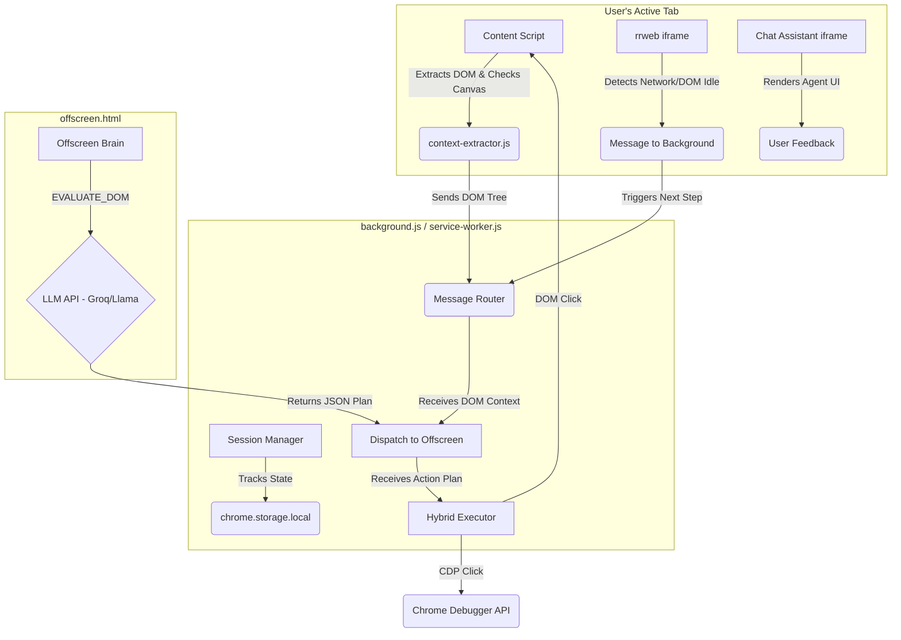

# Phase 1 Execution Analysis & Integration Plan

## Current State Analysis

I have reviewed the codebase and the execution of the 8 tasks from the `PHASE_1_DETAILED_PLAN.md`. While the AI agent successfully **created** all the required files and implemented the internal logic within them, it **failed to integrate** them into the core execution flow of the extension.

Here are the specific findings:

1. **Environment & Config Setup (`config.js`)**: Created correctly and added to `.gitignore`.
2. **Global Session Manager (`session-manager.js`)**: Created correctly and initialized in `service-worker.js`, but its `refreshSnapshot` heartbeat is not running.
3. **Adaptive Context Extractor (`context-extractor.js`)**: Implemented beautifully with both Lyto's text extraction and TipTour's canvas detection.
4. **Hybrid Execution Engine (`hybrid-executor.js`)**: Created as a class, but it is **never imported or used** anywhere in the codebase.
5. **The Offscreen Brain (`offscreen.js`)**: The document is successfully booted by `service-worker.js`, but the background script never actually sends the `EVALUATE_DOM` message to trigger the LLM inference.
6. **MultiOn-Style Tracking & UI (`rrweb-tracker.js`, `chat_assistant.html`)**: The files were created and registered in `manifest.json`, but there is **no code injecting them** into the host page.
7. **Legacy Code Remains**: `service-worker.js` still contains 1,400+ lines of the old architecture (including UI-TARS and the old `executeGuidancePipeline`).

**Conclusion**: The changes will **not work properly** as-is because they are creating a parallel, disconnected architecture. The new systems exist, but they have not been paired with the existing execution flow.

---

## Target Architecture Flowchart

Below is a flowchart of how the systems *should* interact once properly integrated.

---

## User Review Required

> [!WARNING]
> The current `service-worker.js` is massive (1400+ lines) and still relies on the old `executeGuidancePipeline` which uses OpenRouter and UI-TARS. We need to strip this out and replace it with the new Offscreen LLM architecture. This is a significant refactor.

> [!CAUTION]
> The old `groq-mapper.js` and `step-normalizer.js` might no longer be needed if the Offscreen Brain handles the planning directly. I recommend we delete or deprecate them to avoid maintaining two separate codebases.

## Proposed Integration Changes

### 1. Refactor `background/service-worker.js`
- **[MODIFY]** [service-worker.js](file:///Users/ishitjain/followme-extension/background/service-worker.js): Remove the legacy `executeGuidancePipeline` and UI-TARS logic.
- **[MODIFY]** [service-worker.js](file:///Users/ishitjain/followme-extension/background/service-worker.js): Import and instantiate `HybridExecutor`.
- **[MODIFY]** [service-worker.js](file:///Users/ishitjain/followme-extension/background/service-worker.js): Wire the messaging system so that when the Content Script sends the extracted DOM, the Service Worker forwards it to the Offscreen Brain (`EVALUATE_DOM`).
- **[MODIFY]** [service-worker.js](file:///Users/ishitjain/followme-extension/background/service-worker.js): Implement the heartbeat interval for `SessionManager.refreshSnapshot()`.

### 2. Inject Iframes (MultiOn-Style)
- **[MODIFY]** [content.js](file:///Users/ishitjain/followme-extension/content/content.js): Update it to dynamically inject the `chat_assistant.html` and `rrwebiframe.html` as sandboxed iframes into the host page upon initialization.

### 3. Wire the Hybrid Executor
- **[MODIFY]** [service-worker.js](file:///Users/ishitjain/followme-extension/background/service-worker.js): When the Offscreen Brain returns a JSON plan, the Service Worker will pass this to `hybridExecutor.execute()`.

### 4. Cleanup Dead Code
- **[DELETE]** Unused legacy mapper files (if agreed upon), such as parts of [groq-mapper.js](file:///Users/ishitjain/followme-extension/brain/groq-mapper.js) or [step-normalizer.js](file:///Users/ishitjain/followme-extension/brain/step-normalizer.js) that conflict with the new flow.

## Verification Plan
1. Ensure the extension reloads without errors.
2. Verify `SessionManager` state updates in the `debug.html` page when switching tabs.
3. Verify that the `chat_assistant.html` overlay successfully injects into pages.
4. Verify that the Offscreen Brain is successfully receiving `EVALUATE_DOM` messages and making API calls.
